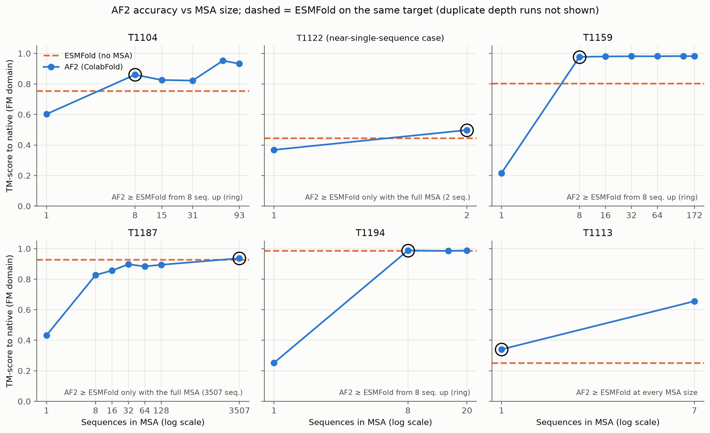
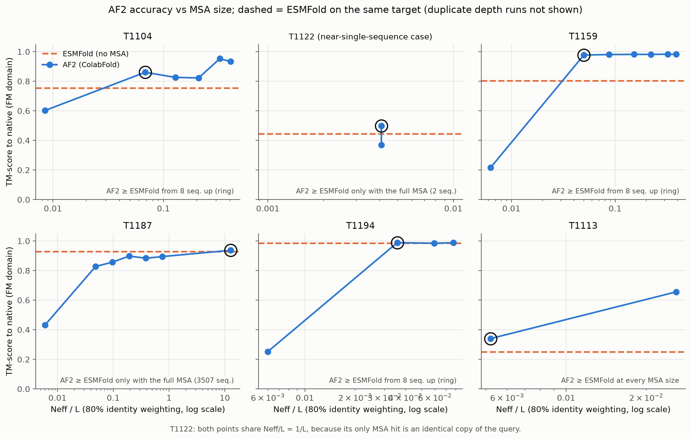
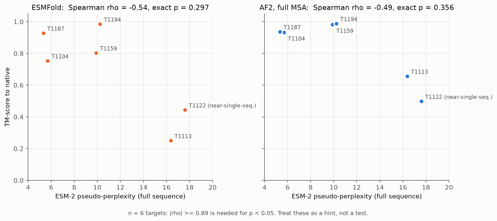
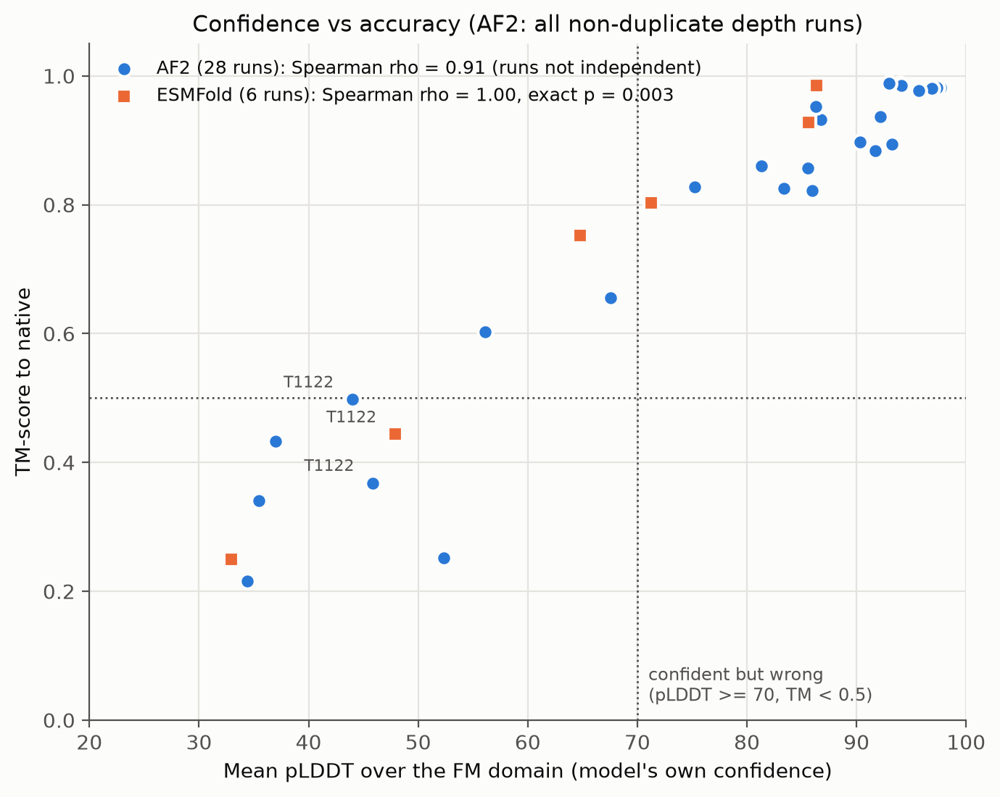
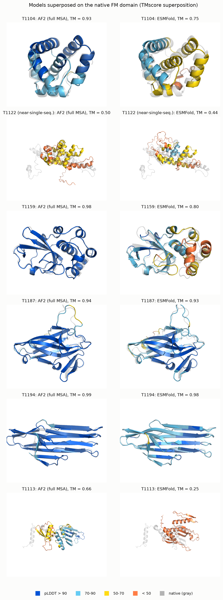
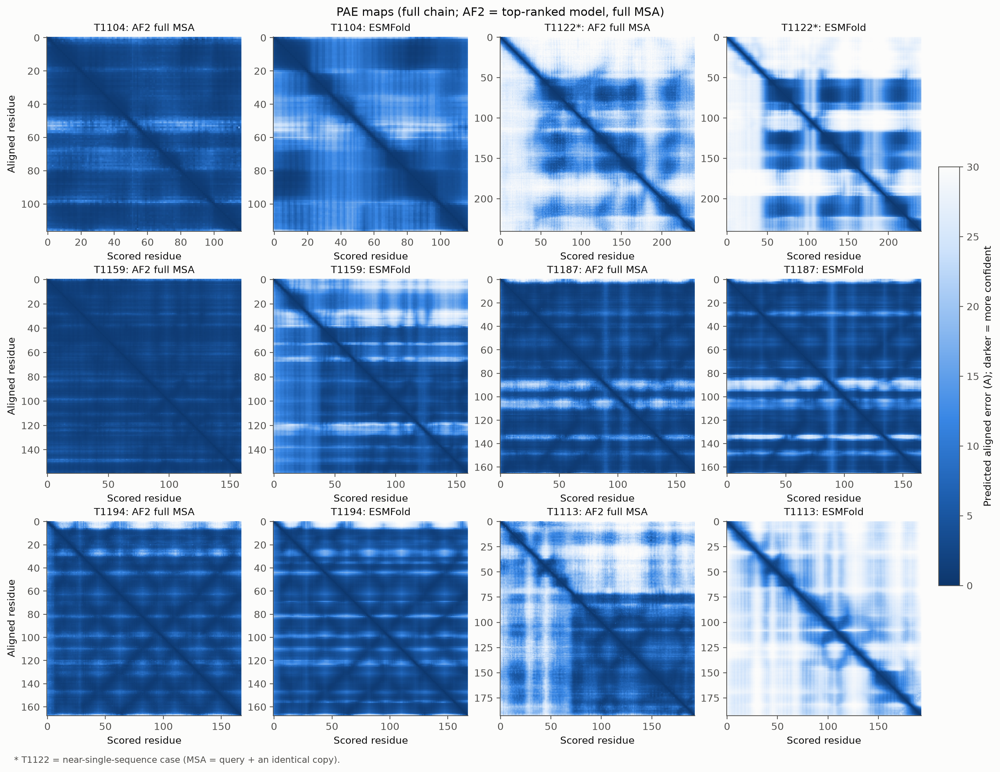
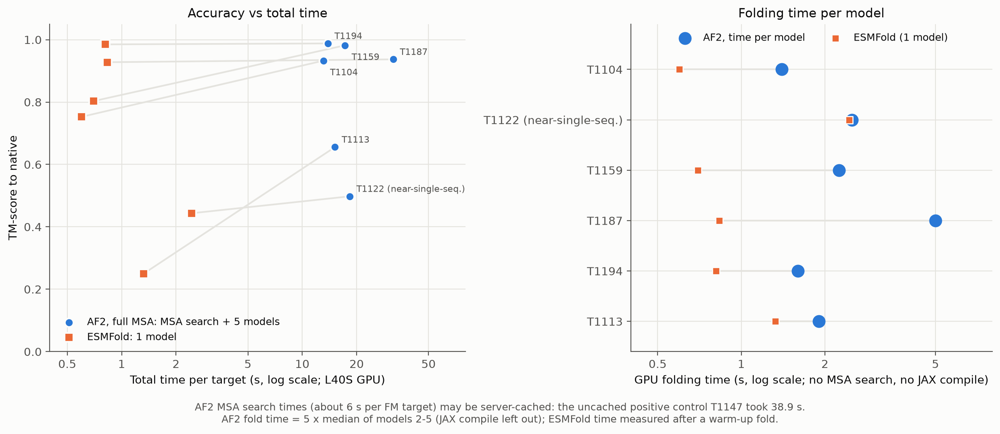
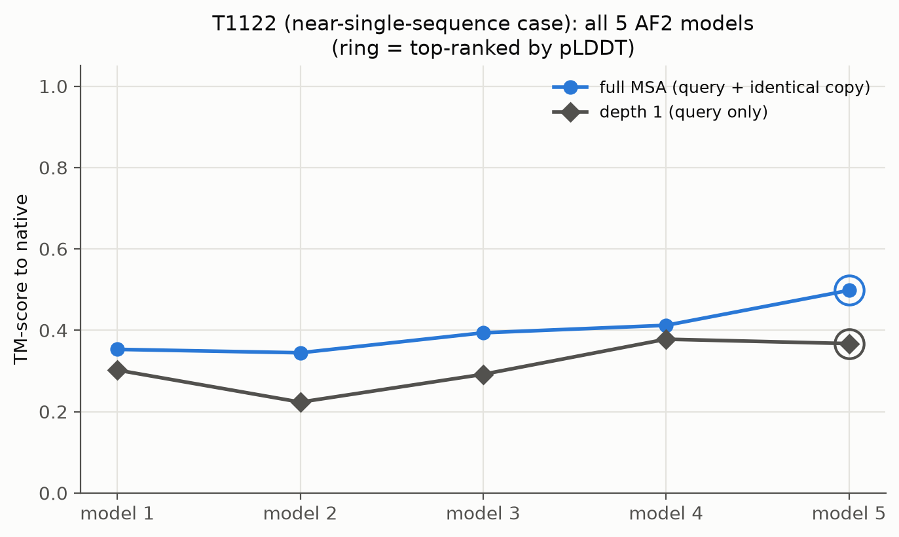

# CASP15 FM: AlphaFold2 (ColabFold) vs ESMFold

CMP_SC 8170, Project 3 (Prof. Jianlin Cheng). Nancy Ihechu.

This project compares two structure predictors on 6 CASP15 free-modeling (FM) targets:

- **AlphaFold2** through ColabFold (`colabfold_batch`, `alphafold2_ptm` weights), which uses a
  multiple sequence alignment (MSA). Templates are off, because these structures are now in the PDB.
- **ESMFold**, which uses the single sequence only (no MSA).

Questions:
1. At what MSA depth does AlphaFold2 drop to ESMFold's accuracy?
2. Does ESM-2 pseudo-perplexity tell us in advance which targets are hard?
3. Trade-off: how much accuracy do we lose with ESMFold, and how much time do we save?

Targets (whole protein = one FM domain; CASP numbering): T1104, T1122, T1159, T1187, T1194, T1113
(see `config/targets.yaml`). **T1122 is our near-single-sequence case**: its MSA holds only the
query plus an identical copy of itself (the same UniProt entry), so it gives no real depth curve.
It answers a different question: does ESMFold match or beat AF2 when the MSA is empty?

## Method in short

| Step | What | Script |
|---|---|---|
| collect | CASP15 sequences; natives from the CASP15 domain files, or from RCSB (renumbered to CASP numbering, trimmed to the FM domain) | `scripts/collect_inputs.py` |
| msa | one MSA per target from the ColabFold MMseqs2 server, timed | `scripts/get_msa.py` |
| sweep | random subsamples (seed 0) of each MSA: full, 128, 64, 32, 16, 8, 1 sequences | `scripts/make_sweep.py` |
| af2 | ColabFold, 5 models, 3 recycles, seed 0, no templates, no relax; top model by pLDDT | `scripts/run_af2.py` |
| esmfold | ESMFold on each sequence | `scripts/run_esmfold.py` |
| perplexity | ESM-2 3B pseudo-perplexity (mask one position at a time) | `scripts/perplexity.py` |
| evaluate | trim to FM domain; TM-score, GDT-TS, RMSD (TMscore), all-atom lDDT (OpenStructure); Neff and input checks | `scripts/msa_stats.py`, `scripts/evaluate.py` |
| analyze | tables and figures, from `results/` only | `scripts/analyze.py`, `notebooks/analysis.ipynb` |

All GPU jobs ran on an NVIDIA L40S. Only the evaluate step reads the native structures.

**MSA depth on the plots is the actual number of sequences AF2 used, not the planned depth.**
The MSA server lists the query twice (once per database section) and ColabFold drops the second
copy, so a planned depth N can hold N-1 sequences. When a target has fewer sequences than a planned
depth, that run repeats the full MSA; these duplicate runs are marked `is_duplicate_depth` in
`results/tables/all_runs.csv` and left out of the depth analysis. Neff uses sequence weighting at
80% identity; Neff/L divides by the full sequence length.

**Timing.** AF2 fold time is 5 x the median time of models 2-5: model 1 also pays a one-off JAX
compilation, which is left out (the raw sum is kept as `fold_time_raw_s`). ESMFold time is
`model.infer()` after one warm-up fold. AF2 total time = MSA search + folding of 5 models; AF2 time
per model = fold time / 5. Model loading is not counted for either method.

## Results

All numbers below are generated from the pipeline's tables (`results/tables/`).

<!-- results:start -->
<!-- This block is generated by scripts/analyze.py from results/tables/*.csv. Do not edit. -->
### Main results (FM domain; AF2 = top-ranked of 5 models)
| target | MSA seqs (full) | Neff/L (full) | AF2 full TM | AF2 1-seq TM | ESMFold TM | AF2 full lDDT | ESMFold lDDT | AF2 full pLDDT | ESMFold pLDDT | ESM-2 perplexity |
|---|---|---|---|---|---|---|---|---|---|---|
| T1104 | 93 | 0.406 | 0.933 | 0.602 | 0.753 | 0.842 | 0.609 | 86.7 | 64.8 | 5.70 |
| T1122 (near-single-seq.) | 2 | 0.004 | 0.498 | 0.368 | 0.444 | 0.451 | 0.415 | 44.0 | 47.9 | 17.61 |
| T1159 | 172 | 0.387 | 0.982 | 0.216 | 0.803 | 0.924 | 0.676 | 97.6 | 71.3 | 9.90 |
| T1187 | 3507 | 12.726 | 0.937 | 0.432 | 0.928 | 0.868 | 0.830 | 92.2 | 85.7 | 5.33 |
| T1194 | 20 | 0.077 | 0.988 | 0.252 | 0.985 | 0.889 | 0.867 | 94.0 | 86.3 | 10.24 |
| T1113 | 7 | 0.026 | 0.656 | 0.340 | 0.250 | 0.704 | 0.326 | 67.6 | 33.0 | 16.37 |

### Smallest MSA where AF2 is at or above ESMFold (TM-score)
Duplicate depth runs left out. Differences below about 0.01 TM are within run-to-run noise.
| target | ESMFold TM | smallest MSA with AF2 >= ESMFold (seqs) | Neff/L there | AF2 TM there | margin (TM) | AF2 stays >= ESMFold with more seqs |
|---|---|---|---|---|---|---|
| T1104 | 0.753 | 8 | 0.068 | 0.860 | 0.108 | yes |
| T1122 (near-single-seq.) | 0.444 | 2 | 0.004 | 0.498 | 0.054 | yes |
| T1159 | 0.803 | 8 | 0.050 | 0.977 | 0.174 | yes |
| T1187 | 0.928 | 3507 | 12.726 | 0.937 | 0.009 | yes |
| T1194 | 0.985 | 8 | 0.036 | 0.988 | 0.003 | yes |
| T1113 | 0.250 | 1 | 0.005 | 0.340 | 0.090 | yes |

### ESM-2 perplexity vs accuracy (Spearman, exact permutation p)
n = 6 targets: |rho| >= 0.89 is needed for p < 0.05.
| x | y | rho | exact p (n = 6) |
|---|---|---|---|
| pseudo_perplexity_full | esmfold_tm | -0.543 | 0.297 |
| pseudo_perplexity_full | af2_full_tm | -0.486 | 0.356 |
| pseudo_perplexity_full | af2_minus_esmfold_tm | 0.143 | 0.803 |
| pseudo_perplexity_domain | esmfold_tm | -0.543 | 0.297 |
| pseudo_perplexity_domain | af2_full_tm | -0.486 | 0.356 |
| pseudo_perplexity_domain | af2_minus_esmfold_tm | 0.143 | 0.803 |
| mean_plddt [ESMFold] | tm_score | 1.000 | 0.003 |

### Confidence vs accuracy (AF2: non-duplicate depth runs)
| method | runs | confident_and_right | confident_but_wrong | unsure_but_right | unsure_and_wrong |
|---|---|---|---|---|---|
| AF2 | 28 | 20 | 0 | 2 | 6 |
| ESMFold | 6 | 3 | 0 | 1 | 2 |

### Speed (L40S GPU)
| target | AF2 MSA search (s) | AF2 fold, 5 models (s) | AF2 per model (s) | ESMFold, 1 model (s) | AF2/ESMFold per model | AF2 total (s) | AF2/ESMFold total | TM lost with ESMFold |
|---|---|---|---|---|---|---|---|---|
| T1104 | 6.08 | 7.00 | 1.40 | 0.60 | 2.3 | 13.08 | 21.8 | 0.180 |
| T1122 (near-single-seq.) | 5.82 | 12.50 | 2.50 | 2.44 | 1.0 | 18.32 | 7.5 | 0.054 |
| T1159 | 5.97 | 11.25 | 2.25 | 0.70 | 3.2 | 17.22 | 24.7 | 0.179 |
| T1187 | 6.85 | 25.00 | 5.00 | 0.83 | 6.0 | 31.85 | 38.3 | 0.009 |
| T1194 | 5.84 | 8.00 | 1.60 | 0.81 | 2.0 | 13.84 | 17.0 | 0.003 |
| T1113 | 5.68 | 9.50 | 1.90 | 1.32 | 1.4 | 15.18 | 11.5 | 0.406 |

MSA search times for the FM targets (5.7-6.8 s) may be cached by the ColabFold server: the positive control T1147, searched the same way, took 38.9 s.

### Positive control: T1147 (easy TBM target, not in the main results)
| method | n_sequences | tm_score | gdt_ts | lddt | mean_plddt |
|---|---|---|---|---|---|
| AF2 | 4510.000 | 0.980 | 99.2 | 0.910 | 95.8 |
| ESMFold |  | 0.937 | 94.3 | 0.843 | 86.4 |

<!-- results:end -->

## Figures

| | |
|---|---|
| Fig. 1: AF2 TM-score vs MSA size, ESMFold dashed |  |
| Fig. 1b: same, vs Neff/L |  |
| Fig. 2: ESM-2 perplexity vs TM-score |  |
| Fig. 3: confidence (pLDDT) vs accuracy |  |
| Fig. 4: models on the native, colored by pLDDT |  |
| Fig. 5: PAE maps |  |
| Fig. 6: accuracy vs speed, and time per model |  |
| Fig. S1: T1122, all 5 AF2 models |  |

## Limits

- **Only 6 targets.** Correlations across targets (perplexity vs accuracy) have very little power:
  with n = 6, |rho| must be about 0.89 or more to reach p < 0.05. Read them as hints.
- **One random seed (0) and one MSA subsample per depth.** Small differences between depths can be
  noise. Runs with identical inputs differ slightly on the GPU, and the choice of top model by
  pLDDT can change between runs.
- **MSA search times may be cached.** The ColabFold server may return stored results for these
  well-known sequences; the uncached positive control took much longer (see the Results block).
  So AF2's total time here is probably an underestimate.
- **Today's databases are bigger than in 2022.** These targets were FM during CASP15, but the
  sequence databases have grown since then, so AF2 may find more homologs now than it could during
  CASP15. Our "full MSA" results are therefore an optimistic picture of AF2 on these targets in 2022.
- **pTM is for the whole chain** (as both programs report it); mean pLDDT is over the FM domain.
  ColabFold stores AF2's pTM rounded to 2 decimals.
- Natives from RCSB (T1122, T1159, T1113) can miss a few residues; scores use only residues present
  in the native.

## Positive control

T1147 (an easy template-based target from Project 2, domain 12-103, native PDB 8em5) was run through
the same pipeline (`config/positive_control.yaml`, results in `results/positive_control/`). Both
methods score high on it, which shows the installation works.

## Rerun

Full instructions follow in Stage 6 (`pipeline.py` and `run_agent.sh`).

License: MIT (see `LICENSE`).
